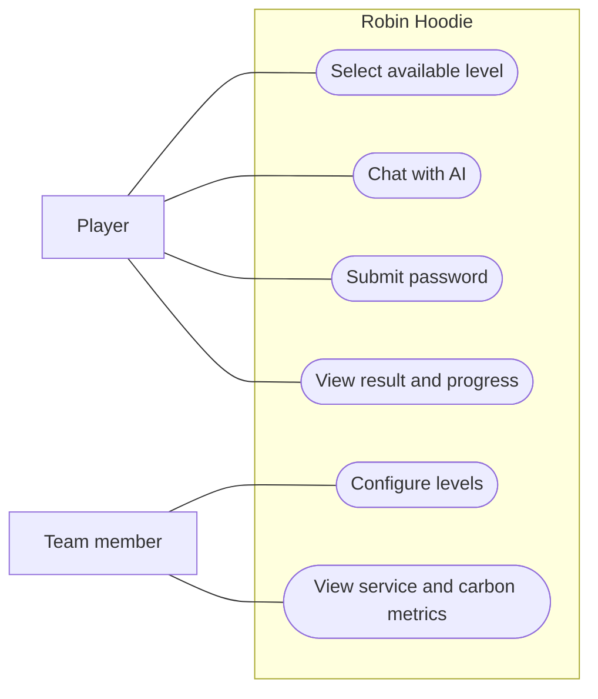
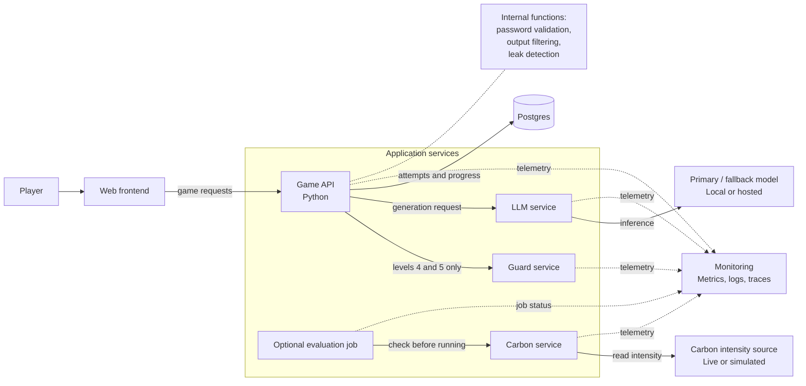
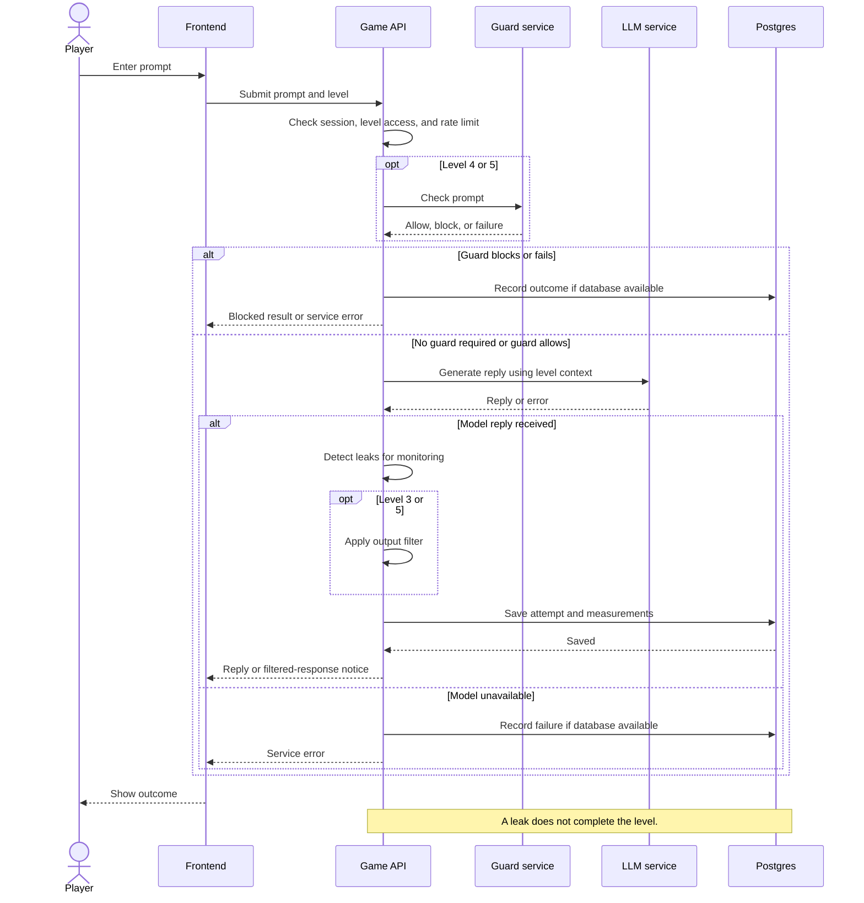
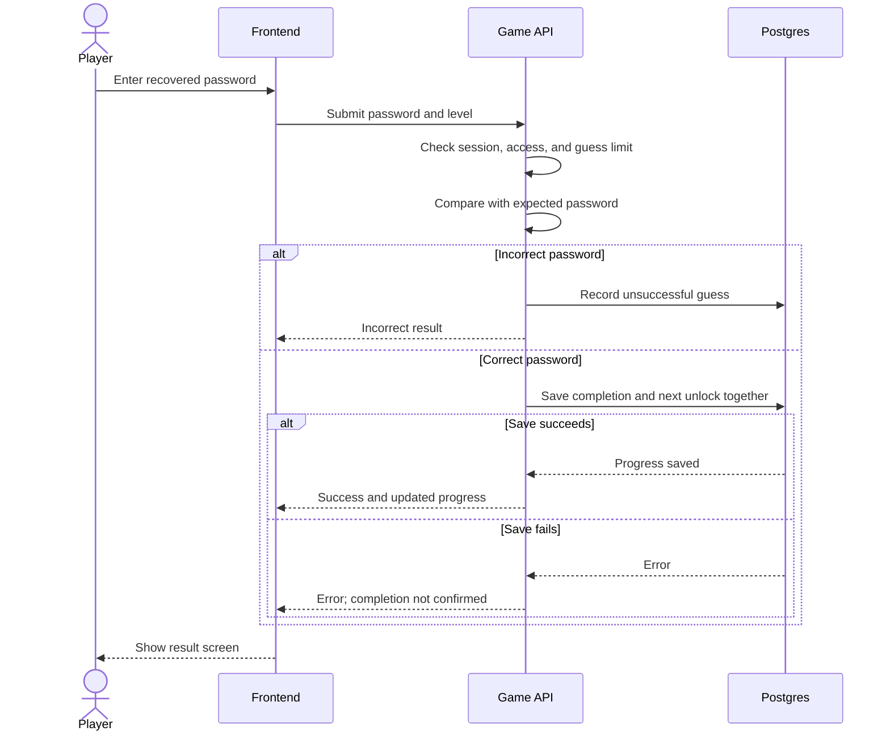
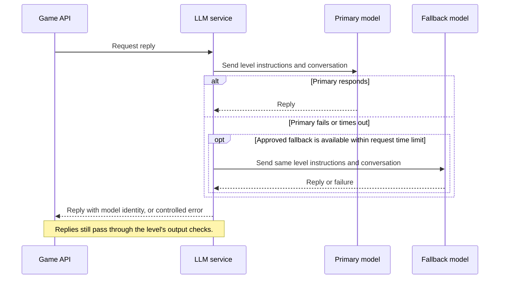
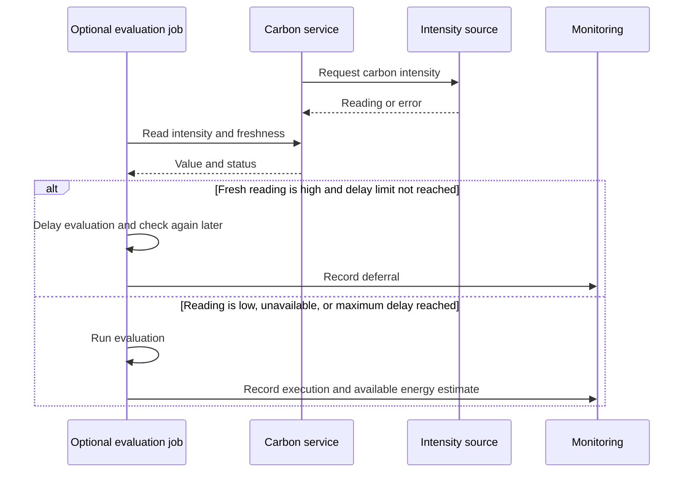

# Robin Hoodie First Iteration

Team: Mario Palagyi, Jerome Puthuparampil, Balqiz Azami
Final Deadline: 4th December
Course: AI Architecture and Cloud Computing

Robin Hoodie is a web application where players try to make an AI model reveal a fictional password. Each level uses a different defense. After finding the password, the player enters it into a validator to complete the level.

This document describes our first design: the project specification, important use cases, UML models, and architecture decisions. It does not describe the full implementation. Python is confirmed for the backend; choices marked **proposed** still need team agreement.

## 1 Project specification

### 1.1 Features

| ID | Feature |
|---|---|
| F1 | Players can select an unlocked level and chat with the AI. |
| F2 | Each level applies its own password defenses, as listed below. |
| F3 | Players enter a recovered password into a separate validator. |
| F4 | The backend checks the password, saves completion, and unlocks the next level. |
| F5 | The application shows replies, blocked attempts, and understandable error messages. |
| F6 | The backend records prompt counts, password guesses, prompt length or token usage, time taken, and estimated carbon footprint where available. |
| F7 | The system collects basic service metrics and demonstrates carbon-aware behavior. |

The game flow is: **select level → chat → find or infer password → submit password → see result → unlock next level**.

Detecting a leaked password in a model response does not complete a level. The player must submit it. Output filtering, leak detection for monitoring, and password validation are separate checks.

### 1.2 Levels

| Level | Password defense |
|---|---|
| 1 | No password defense; the password is included in the model's context. |
| 2 | A system instruction tells the model not to reveal the password. |
| 3 | The system instruction plus a filter that blocks replies containing the exact password. |
| 4 | The system instruction plus an AI input guard. No output filter. |
| 5 | The system instruction, AI input guard, and an output filter for exact matches and selected transformations, such as base64 or added spaces. |

Levels 1–3 do not call the guard. The defenses are not fully cumulative: level 4 replaces the output-filter approach with an input guard. We will test the difficulty of each level. Level 5 will check a defined set of transformations, not every possible encoding.

General model safety applies to all levels. Level 1 has no password protection, but this does not mean removing safeguards against harmful requests. The injection guard is not a replacement for general safety safeguards.

### 1.3 Non-functional properties

These are initial goals and must be checked during implementation.

| Property | Initial goal |
|---|---|
| Performance | Aim for 95% of chat requests to finish within 3 seconds and guard checks within 300 ms, under agreed test conditions. Model choice may require revising these targets. |
| Reliability | Save progress before confirming completion. Show a controlled error when a required service fails. A guard failure must stop guarded requests. |
| Availability | Proposed target of 99%; the measurement period and test environment are still open. |
| Guard quality | Proposed recall of at least 90% on a labelled injection test set. Also measure how often normal prompts are blocked. |
| Security | Check passwords and progress on the backend. Protect real credentials, isolate player sessions, and limit prompt submissions and password guesses. |
| Maintainability | Use Python for the backend, separate the main service responsibilities, and configure levels without rewriting the application. |
| Observability | Record service errors, response times, model usage, and game outcomes without logging passwords or unnecessary private content. |
| Sustainability | Show clearly labelled energy/carbon estimates and demonstrate one carbon-aware action without interrupting gameplay. |

Game passwords may reach players through model replies. They must not be exposed through frontend code, configuration downloads, or validator error messages. They are fictional secrets, never real credentials.

### 1.4 Scope and open questions

There is no leaderboard, live attack feed, event broker, achievement system, or combined score in the first version. Level configuration can use files instead of an admin interface.

| Question | Current position |
|---|---|
| Backend framework | Python confirmed; FastAPI proposed. |
| Frontend | React with TypeScript and Vite is proposed for the web interface. Mantine for UI Library and because it works well with Vite.|
| Player identity | Full accounts or anonymous sessions: still open. |
| AI models | Primary model, fallback model, guard model, and local versus hosted inference: open. |
| Resources | Budget, deadline, team skills, and supported player count: to be filled in. |
| Game details | Password generation, chat history, timer rules, and level reset behavior: to be decided. |
| Deployment | Local Kubernetes demo planned; cloud provider and deployment tools still open. |

CI/CD, monitoring, and carbon behavior remain part of the overall course project. Their detailed setup will be developed later.

## 2 Architecturally significant use cases

These use cases matter because they determine how the services communicate and where decisions and data are handled.

| ID | Use case | Main behavior | Why it matters for the architecture |
|---|---|---|---|
| UC1 | Submit a prompt | Check level access, apply the level's defenses, obtain a model reply, and save the outcome. | Connects the frontend, backend, guard, model, and database. |
| UC2 | Validate a password | Compare the submitted password on the server, save success, and unlock the next level. | Keeps completion and progress under backend control. |
| UC3 | Handle a guard failure | Stop the request and show an error if the required guard fails. | Prevents a service failure from bypassing a level's defense. |
| UC4 | Handle model unavailability | Try an approved fallback model or return an error. | Requires a clear fallback path that preserves the level rules. |
| UC5 | Adapt to carbon intensity | Delay an optional background evaluation when intensity is high. | Adds carbon-aware behavior without changing an active game. |

UC1 and UC2 require an identified player session and an available level. UC3 and UC4 are alternative paths during UC1. UC5 runs independently of player requests.

## 3 Architecture and UML models

The following diagrams are editable Mermaid source. The use-case and component models use flowchart notation to preserve their actors, components, and relationships; the interaction models use sequence diagrams.

### 3.1 Use-case model

The player uses the game. A team member configures levels through files and checks monitoring results; this does not require an admin web interface.

### 3.2 Component model

The Game API handles game rules, password validation, output checks, and progress. These are internal parts of the backend, not separate services. The Guard and LLM services separate AI-specific work from the game logic.

The application services will run in containers on Kubernetes. The optional evaluation can be a scheduled job rather than a permanent service. Model hosting and the monitoring tools are still to be selected; Prometheus and Grafana are candidates.

### 3.3 Sequence model for submitting a prompt

This covers both unguarded and guarded levels. Replies are checked before being sent to the browser on levels with an output filter.

### 3.4 Sequence model for password validation

On the final level, successful validation completes the game. Repeated correct submissions must not create duplicate progress changes.

### 3.5 Sequence model for model fallback

We will test the fallback because it may change difficulty. A safety refusal is not a reason to switch models. If there is no suitable fallback, the application shows an error.

### 3.6 Sequence model for carbon-aware behavior

Our proposed first action is to delay optional background evaluations when carbon intensity is high. Gameplay and required CI checks are not delayed.

Thresholds and maximum delay remain open. Simulated readings must be labelled. Carbon figures are estimates; local measurements do not directly measure the energy used by a hosted model.

## 4 Architecture decisions

These are short first-iteration decision records. “Accepted” records agreed choices; “Proposed” means the team still needs to confirm the choice.

### ADR 1 Python backend and React frontend

- **Status:** Python accepted; frameworks proposed.
- **Context:** We need an interactive chat interface, level selection, and password validation, with a backend that can integrate AI services.
- **Decision:** Use Python for the backend, with FastAPI proposed. Propose React with TypeScript for the frontend and Vite for development and builds. Keep game rules and password checking in the Python backend. Mantine UI library for prettiness.
- **Alternatives considered:** Plain HTML/CSS/JavaScript or a server-rendered interface.
- **Consequences:** React lets us reuse interface components and manage changing chat and game state. TypeScript helps catch data-shape mistakes during development. Both add learning and build setup, so we will keep the interface small and avoid extra frontend infrastructure initially. Visual styling still needs separate attention.

### ADR 2 Separate AI services and keep game rules together

- **Status:** Accepted.
- **Context:** The guard and model have different responsibilities from the game.
- **Decision:** Separate the Game API, Guard service, and LLM service. Keep password validation and output checks inside the Game API. Do not add an event broker or live-feed service initially.
- **Alternatives considered:** One application for everything, or a separate service for each function.
- **Consequences:** The design demonstrates service communication without creating too many components, but network failures must be handled.

### ADR 3 Level-specific defenses and manual completion

- **Status:** Accepted.
- **Context:** Players should experience different defenses and submit the password themselves.
- **Decision:** Call the guard only on levels 4–5 and apply output filters only on levels 3 and 5. Only backend password validation completes a level. A required guard failure stops the request.
- **Alternatives considered:** An always-on guard or automatic completion when a leak is detected.
- **Consequences:** Level behavior is clear and configurable. Difficulty and general model safety still need testing.

### ADR 4 Postgres for progress and attempts

- **Status:** Accepted direction.
- **Context:** Progress and game outcomes must survive application restarts.
- **Decision:** Store them in Postgres, and save completion and unlocking together.
- **Alternatives considered:** In-memory storage or SQLite for a smaller prototype.
- **Consequences:** We gain shared persistent storage but need to configure and maintain a database. Account versus anonymous session design remains open.

### ADR 5 Container deployment on Kubernetes

- **Status:** Kubernetes accepted; tooling and cloud provider open.
- **Context:** The project must demonstrate cloud-oriented architecture and deployment.
- **Decision:** Containerize the services and demonstrate them on a local Kubernetes cluster. Document a suitable cloud target later.
- **Alternatives considered:** Running processes directly or using only Docker Compose.
- **Consequences:** This supports the course goals but adds setup work. Detailed CI/CD and deployment choices belong in the next iteration.

### ADR 6 Carbon-aware background work

- **Status:** Proposed.
- **Context:** We need a visible carbon-aware action without disrupting the game or changing its difficulty mid-session.
- **Decision:** Delay optional evaluations during high carbon intensity, with a maximum delay and a normal schedule when readings are unavailable.
- **Alternatives considered:** Switching to smaller models during gameplay or only displaying a carbon indicator.
- **Consequences:** The action is simple to demonstrate. We still need an estimation method, thresholds, and a clear distinction between live and simulated data.

Further decisions about model selection, fallback, the cloud provider, identity, and monitoring will be recorded when the team selects them.
