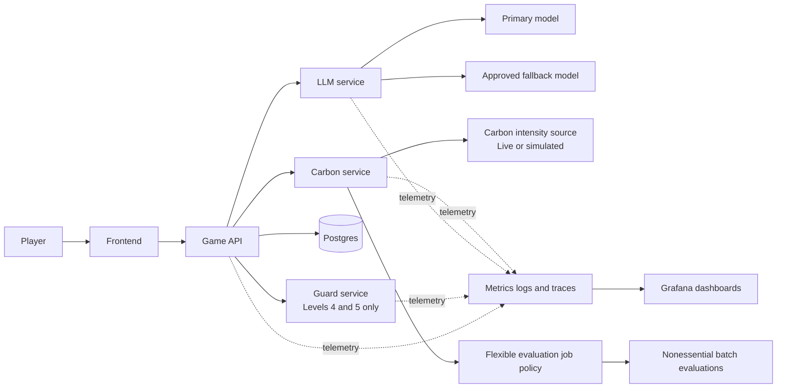
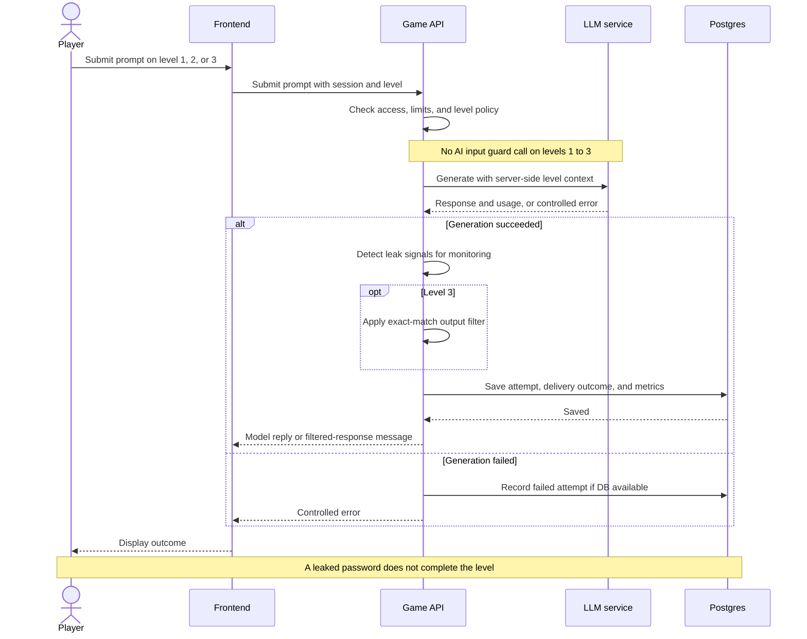
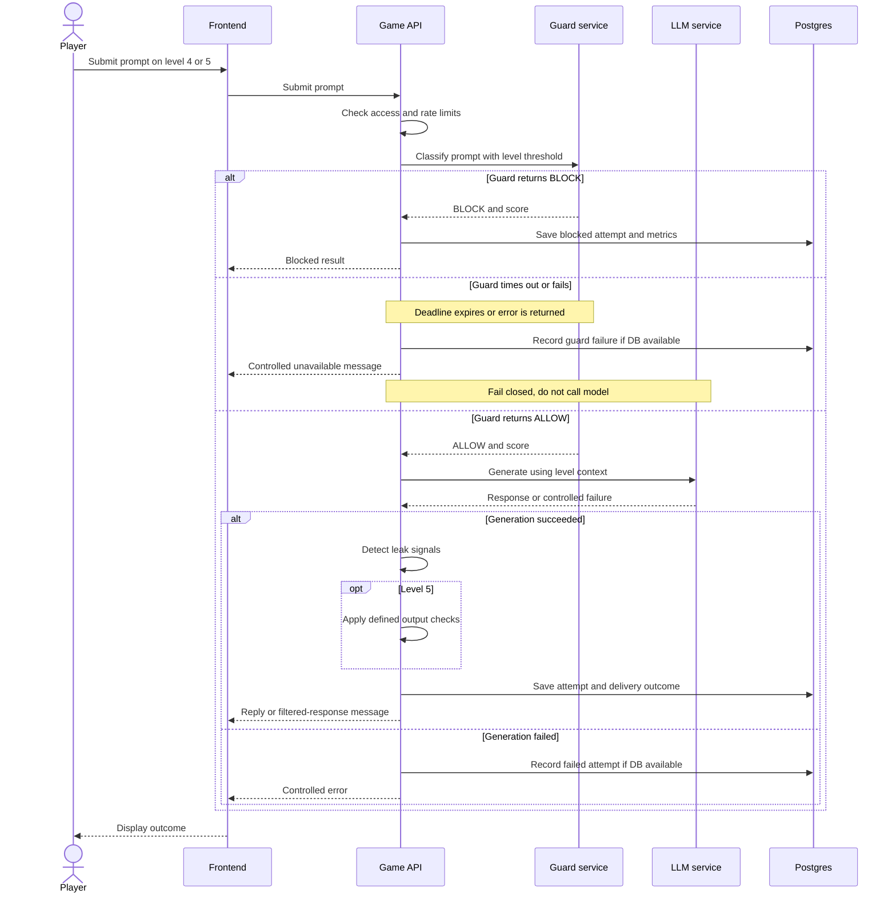
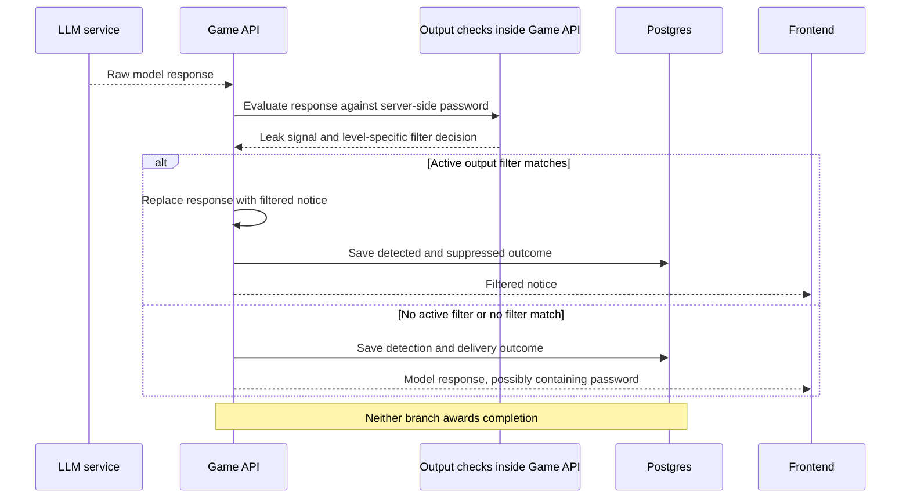
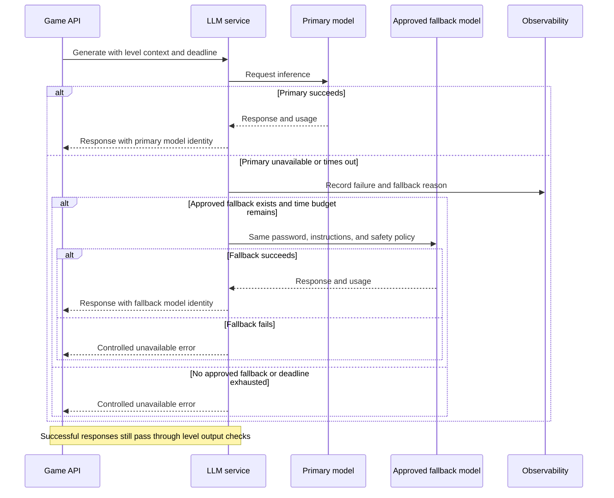

# Robin Hoodie Project Specification

Robin Hoodie is a university project for an AI Architecture and Cloud course. Players try to persuade an AI model to reveal a fictional secret password, then submit that password to a server-side validator to complete a level. Different levels demonstrate different defenses against prompt injection and password disclosure.

The first version focuses on the game loop and the course requirements: containerized services on Kubernetes, architecture decisions, sequence diagrams, CI/CD, observability, and measurable carbon-aware behavior. Leaderboards and achievements are deferred.

This specification records the team's agreed scope. Items marked **Proposed** or **To be decided** are not final commitments. Performance figures are targets, not measured results.

## 1 Project objectives

- Build a playable prompt-injection challenge with five configurable levels.
- Separate password protection, general model safety, and password validation.
- Demonstrate service interactions, failures, persistence, and fallback through UML sequence diagrams.
- Deploy and observe a small containerized system using Kubernetes.
- Measure or estimate environmental impact transparently and demonstrate an adaptation policy.
- Keep the implementation manageable for a three-person university team.

Only fictional game passwords are used. They must never be reused as application credentials or infrastructure secrets.

## 2 Scope

### Initial version

- Level selection, chat, password submission, result screen, and saved progress.
- Five levels with configuration-driven defenses.
- Server-side password validation and level unlocking.
- Guard enforcement on levels 4 and 5 only.
- Output filtering on levels 3 and 5 only.
- Protected-model access with controlled failure handling and a fallback path.
- Per-session or per-account rate limits for chat and password guesses.
- Gameplay metrics, operational dashboards, and carbon estimates.
- Kubernetes deployment, automated delivery checks, ADRs, and diagrams.

### Deferred features

- Public leaderboard and live attack feed.
- Event broker and separate live-feed service.
- Combined scoring formula and competitive rankings.
- Achievements such as completing a level with one prompt.
- Graphical administration interface; use version-controlled level configuration initially.

Full accounts versus anonymous sessions remains an open decision. Both options must support server-side progress and session isolation.

## 3 Game behavior

### Player journey

Select an available level → chat with the model → obtain or infer the password → enter it in the validator → receive success or failure → unlock the next level on success.

A model response that contains the password does **not** automatically complete the level. Players may reconstruct a password from several responses. Completion occurs only after a correct submission to the backend validator.

### Level definitions

| Level | Password-specific defenses | AI input guard | Output filter |
|---|---|---|---|
| 1 | None; the fictional password is present in model context | Not called | None |
| 2 | System instruction tells the model to protect the password | Not called | None |
| 3 | System instruction plus exact-match output filtering | Not called | Exact password match |
| 4 | System instruction plus AI input guard | Enforced | None |
| 5 | System instruction plus AI input guard and defined transformed-leak checks | Enforced | Exact match and specified transformations |

Levels 4 and 5 explore guard-based defenses. The progression is not strictly cumulative: level 4 does not retain level 3's output filter. Actual difficulty will be tested rather than assumed from level number.

Level 5's initial transformation set may include case normalization, whitespace removal, and base64 decoding. The exact set, decoding limits, and test cases must be documented. The filter does not claim to detect every possible encoding or indirect disclosure.

Each level should have a YAML configuration containing its ID, instruction template, guard setting and threshold where applicable, output-filter mode, and model policy. Password provisioning is server-side; downloadable configuration must not contain passwords.

### General model safety

General safety safeguards apply at every level, including level 1. The game should not assist harmful requests involving illegal activity, dangerous conduct, or prohibited explicit content. The exact safety policy and model behavior must be selected and tested.

“No defense” at level 1 means no password-specific defense. It does not mean disabling general model safety. The prompt-injection classifier is not assumed to be a general content-safety classifier. Any additional safety mechanism must be documented separately and must not accidentally introduce password protection into the unguarded levels.

### Three separate checks

| Check | Purpose | Effect |
|---|---|---|
| Output filter | Enforce the level's password protection | Suppresses a matching model response on levels 3 and 5 |
| Leak detector | Observe defined disclosure patterns | Records a detection signal; never awards completion |
| Password validator | Compare a player-submitted answer with the level password | Awards completion and unlocks the next level if correct |

Leak detection should distinguish a detected leak in a raw model response from a leak actually delivered to the player. A detected response may have been suppressed by an output filter. Detector misses are possible; a successful password submission remains valid even if no leak was detected.

**Proposed validation rule:** compare submitted passwords exactly, with any whitespace normalization explicitly agreed and tested. Completion is idempotent: repeated correct submissions must not duplicate rewards or progress updates.

## 4 Functional requirements

| ID | Requirement |
|---|---|
| FR-01 | Identify the player through an account or anonymous session; the choice remains open. |
| FR-02 | Show levels and enforce availability using server-side progress. |
| FR-03 | Accept chat prompts and return replies or clear blocked/error outcomes. |
| FR-04 | Call and enforce the AI guard only for levels 4 and 5. |
| FR-05 | Stop guarded requests when the guard blocks, times out, or fails. |
| FR-06 | Apply the selected level's instructions and output-filter policy. |
| FR-07 | Allow players to submit password guesses through a separate validator interface. |
| FR-08 | Save successful validation and unlock the next level on the server. |
| FR-09 | Record chat attempts, validation attempts, outcomes, and useful measurements. |
| FR-10 | Keep automatic leak detection independent of completion. |
| FR-11 | Rate-limit chat submissions and password guesses. |
| FR-12 | Handle unavailable models through an approved fallback or controlled error. |
| FR-13 | Expose operational metrics and carbon-policy status. |
| FR-14 | Demonstrate carbon-aware adaptation using live or clearly labelled simulated intensity data. |
| FR-15 | Maintain general model safety across every level and fallback model. |

## 5 Architecture

### Components and responsibilities

| Component | Responsibility |
|---|---|
| Frontend | Level selection, chat, password entry, result screen, and carbon-policy indicator |
| Game API | Sessions, access checks, level policies, rate limits, validation, output checks, progress, and attempt persistence |
| Guard service | Prompt-injection classification for guarded levels; returns a decision and score |
| LLM service | Construct model requests, call the protected model, apply approved fallback policy, report usage |
| Postgres | Store sessions or users, attempts, validation outcomes, and progress |
| Carbon service | Obtain carbon intensity, expose freshness and source, and support the adaptation policy |
| Monitoring stack | Collect metrics, logs, and traces; display dashboards |

Password validation, output filtering, and leak detection are internal Game API components, not separate deployed services. There is no event broker in the initial architecture.

Model hosting is undecided: hosted inference or a local model runtime are both candidates. The guard is intended to use an off-the-shelf prompt-injection classifier; model and threshold selection remain open.

### Component diagram



The batch-policy component can be a small worker or scheduled job; it does not require a broker or dedicated long-running service. Browser telemetry, if added, goes through an appropriate collection endpoint rather than exposing a browser `/metrics` endpoint.

### Deployment direction

- Run application services as separate containers on a local Kubernetes cluster for the demo.
- Choose kind or minikube and document the decision.
- Describe a concrete cloud deployment target in an ADR, clearly distinguishing planned cloud deployment from what was actually demonstrated locally.
- **Proposed:** use Helm for Kubernetes packaging. Introduce Terraform only if cloud infrastructure provisioning is included; it is not required merely to package workloads.
- Keep model credentials and other operational secrets out of browser responses, source control, and logs.
- Include resource requests and limits, health probes, and a persistent database volume.

## 6 Sequence diagrams

These diagrams are a primary course deliverable. They describe logical interactions; internal checks do not imply additional microservices. General safety behavior applies within the model path in every diagram.

### 6.1 Prompt on a level without an input guard



### 6.2 Guarded prompt with block and failure branches



### 6.3 Output filtering and leak observation



**Proposed:** buffer model responses until output checks finish. Streaming unchecked tokens could expose a password before the filter can suppress it.

### 6.4 Password validation and level unlocking

```mermaid
sequenceDiagram
    actor Player
    participant UI as Frontend
    participant API as Game API
    participant Validator as Validator inside Game API
    participant DB as Postgres
    Player->>UI: Enter recovered password
    UI->>API: Submit guess with session and level
    API->>API: Check level access and guess rate limit
    API->>Validator: Compare guess with server-side password
    Validator-->>API: Correct or incorrect
    alt Incorrect
        API->>DB: Save unsuccessful validation attempt
        DB-->>API: Saved
        API-->>UI: Incorrect result; allow another try
    else Correct
        API->>DB: Transaction: save validation, completion, and next unlock
        alt Transaction committed
            DB-->>API: Saved progress, including existing completion if repeated
            API-->>UI: Success and current available levels
        else Database failure
            DB-->>API: Transaction failed
            API-->>UI: Controlled error; progress not confirmed
        end
    end
    UI-->>Player: Show result screen
```

The last level produces a game-complete result instead of unlocking a nonexistent next level. An incorrect guess must not return the expected password.

### 6.5 Model failure and fallback



A fallback may change difficulty even with identical instructions. Test it per level, record its identity, and use a controlled error if no acceptable fallback is configured. A safety refusal is not an availability failure and must not trigger a fallback intended to bypass safeguards.

### 6.6 Carbon-aware scheduling

**Proposed initial adaptation:** defer nonessential batch evaluations during high carbon intensity. Interactive gameplay and mandatory CI checks remain available. Model switching during a player session is not part of the initial carbon policy.

```mermaid
sequenceDiagram
    participant Source as Carbon intensity source
    participant Carbon as Carbon service
    participant Scheduler as Batch policy worker
    participant Job as Optional batch evaluation
    participant Obs as Observability
    Carbon->>Source: Request intensity for configured zone
    alt Fresh data available
        Source-->>Carbon: Intensity, timestamp, and source
        Carbon->>Carbon: Cache reading and freshness
    else Source unavailable
        Carbon->>Carbon: Mark stale or unavailable
    end
    Scheduler->>Carbon: Read intensity and freshness
    Carbon-->>Scheduler: Value, source, freshness, simulation flag
    alt Fresh intensity above threshold and deferral budget remains
        Scheduler->>Scheduler: Defer optional job
        Scheduler->>Obs: Record deferral and reason
    else Fresh intensity acceptable
        Scheduler->>Job: Run evaluation
        Job->>Obs: Record work, duration, and energy estimate
    else Data stale or unavailable, or maximum delay reached
        Scheduler->>Job: Run under normal schedule policy
        Scheduler->>Obs: Record policy fallback; no unsupported green claim
    end
    Note over Scheduler,Job: Interactive requests and mandatory release checks are never deferred
```

The intensity threshold, polling interval, freshness limit, and maximum deferral period remain open. A mock source must demonstrate low intensity, high intensity, and unavailable-data behavior with clearly labelled simulated readings.

### 6.7 CI/CD

```mermaid
sequenceDiagram
    actor Developer
    participant Repo as GitHub repository
    participant CI as CI runner
    participant Registry as Container registry
    participant Cluster as Demo Kubernetes cluster
    Developer->>Repo: Push change or open pull request
    Repo->>CI: Start workflow
    CI->>CI: Lint, unit tests, integration tests, and safety regressions
    CI->>CI: Dependency, source, secret, and image checks
    CI->>CI: Build images and validate deployment templates
    alt Required checks fail
        CI-->>Repo: Failed status; stop release
    else Required checks pass
        CI-->>Repo: Passed status
        opt Authorized deployment branch or manual deployment
            CI->>Registry: Push versioned images
            CI->>Cluster: Deploy release
            CI->>Cluster: Check readiness and run smoke tests
            alt Healthy deployment
                CI-->>Repo: Deployment successful
            else Deployment unhealthy
                CI->>Cluster: Roll back application release where supported
                CI-->>Repo: Deployment failed
            end
        end
    end
```

The deployment runner needs an explicit connection to the demo cluster. A local cluster is not assumed to be reachable from a hosted runner. Select a local runner or another documented deployment arrangement. Manifest validation alone is not an actual deployment.

## 7 Data and measurement

### Suggested records

| Record | Suggested fields |
|---|---|
| Session or user | Identifier, creation time, identity type |
| Chat attempt | Attempt ID, session, level and config version, timestamp, outcome, model identity, guard decision if applicable, filter outcome, latency |
| Usage measurement | Prompt characters, available input/output token counts, measurement source, estimated cost |
| Validation attempt | Session, level, timestamp, correct/incorrect outcome; do not store plaintext guess by default |
| Progress | Session, level, completion time, unlock state |
| Carbon measurement | Workload boundary, energy estimate, intensity, zone, timestamp, source, simulation flag, allocation method |

Use request identifiers to correlate records, logs, and traces. Avoid storing raw prompts and responses by default; they can contain personal information or the game password. Any retained evaluation examples need an explicit retention and access policy.

### Gameplay measurements

- Count chat submissions separately from password guesses.
- Count blocked and failed submissions, with separate outcome categories.
- Record prompt length and available token usage without assuming all models expose identical counters.
- **Proposed timer:** start at the first accepted chat submission for a level and stop at successful validation; document how resets and inactive sessions are handled.
- Record the level and its configuration version rather than applying an untested difficulty multiplier.
- Present carbon estimates separately from token efficiency; fewer tokens do not automatically establish lower emissions.

There is no combined score in the initial version. Later scoring can use these records without dictating the first implementation.

## 8 Observability and proposed SLOs

Collect metrics, structured logs, and correlated traces. Prometheus and Grafana are the proposed metrics/dashboard tools; OpenTelemetry is a candidate for instrumentation. Log and trace storage choices remain open.

### Dashboard coverage

- Request volume, error rate, and availability.
- p50/p95 latency for the API, guard, model calls, and complete chat requests.
- CPU, memory, and available accelerator utilization.
- Guard block rate and score distribution, separated by level.
- Detected raw leaks, suppressed responses, and detected delivered leaks.
- Successful password validations and level completions.
- Model usage, fallback rate, safety refusals, and estimated cost.
- Carbon intensity, freshness, energy estimates, estimated emissions, and deferred jobs.

Do not use session IDs, raw prompts, or passwords as metric labels. Guard recall comes from a labelled evaluation set, not from live block rate. Leak detection metrics are imperfect observations, not proof that no other leaks occurred.

### Targets pending confirmation

| Measure | Proposed target | Measurement or decision needed |
|---|---|---|
| Complete chat latency | p95 below 3 seconds | Measure to final checked response; fix hardware, model, token limit, load, and treatment of failures |
| Guard latency | p95 below 300 ms | Guarded requests only; define warm versus cold behavior |
| Availability | At least 99% | Define valid requests, observation window, and infrastructure scope; short demos cannot prove long-term availability |
| Guard recall | At least 90% | Versioned labelled injection test set; report sample size and false positives too |
| Concurrent usage | Explore target of 100 players | Treat as a load-test hypothesis, subject to model capacity and budget |
| Progress durability | No acknowledged completion lost in tested failure cases | Verify transactional completion and restart behavior |
| General safety | To be decided | Define policy, labelled cases, and pass criteria separately from injection recall |
| Optional-job maximum delay | To be decided | Carbon deferral must remain within the agreed scheduling bound |

A deliberately blocked attack is an expected application outcome, not an infrastructure outage. A guard timeout that prevents play is a service failure, even though it fails securely. Carbon adaptation must be evaluated against the same latency, availability, and quality criteria.

## 9 Carbon measurement and adaptation

### Measurement boundary

For local workloads, evaluate an energy estimator such as CodeCarbon and document which processes or machine resources it covers. Containerized workloads share hardware, so avoid counting the same machine energy independently for multiple services.

Use energy in kWh and carbon intensity in gCO2e/kWh to calculate estimated emissions:

`estimated emissions (gCO2e) = estimated energy (kWh) × carbon intensity (gCO2e/kWh)`

If a tool already provides an emissions estimate, do not multiply that emissions figure by carbon intensity again. Use the underlying energy estimate when applying a separate intensity source. Variable-intensity windows should be calculated over matching time intervals.

For hosted inference, local client energy does not measure provider inference energy. Any hosted-model footprint needs a separately documented estimation method and uncertainty. Do not present it as directly measured server energy.

Per-request estimates require a documented allocation method, including how idle and shared workload energy are handled. Simulation demonstrates policy behavior but does not prove real carbon savings.

### Initial policy proposal

- Obtain intensity from an external source such as Electricity Maps; zone AT is the starting candidate, subject to deployment location and access availability.
- Use a mock source to demonstrate intensity changes reliably.
- Defer only nonessential batch evaluations above an agreed threshold.
- Keep mandatory CI regressions, password validation, and interactive gameplay outside deferral.
- Resume deferred work when intensity drops or the maximum delay is reached.
- Use a normal schedule when intensity is stale or unavailable; expose that condition.
- Show whether data is live or simulated and whether work is actually being deferred.

If measured savings are claimed, compare equivalent work under a documented baseline and adapted schedule. A green indicator by itself is not sufficient evidence of adaptation or reduced emissions.

## 10 Security and reliability

- Intentionally allow fictional passwords to reach players through model responses on levels whose defenses are bypassed.
- Never distribute expected passwords through frontend bundles, ordinary configuration endpoints, validation failures, or client-side validation logic.
- Keep operational credentials entirely separate from game passwords.
- Validate level access, session ownership, completion, and unlocks on the server.
- Apply separate limits to prompts and password guesses, including payload and generation limits.
- Fail closed on guard errors for levels 4 and 5; unguarded levels must not depend on guard availability.
- Apply output filtering before delivering any content on filtered levels.
- Save completion and unlock changes atomically; do not announce success before commit.
- Use bounded timeouts and retries. Do not duplicate model calls or saved attempts through uncontrolled retries.
- Prevent concurrent sessions from sharing conversation history or progress accidentally.
- Keep game model execution isolated from real tools, credentials, and privileged system access.
- Set a model spending cap if hosted inference is selected.

## 11 CI/CD and verification

The pipeline should run linting, unit tests, integration checks, dependency/security checks, image builds and scans, and Kubernetes-template validation. Select exact tools after the language and deployment stack are chosen. Candidates include GitHub Actions, Trivy, and language-appropriate scanners such as Bandit or pip-audit for Python.

Required test cases include:

- Levels 1–3 never call the guard; levels 4–5 enforce it.
- Guard block, timeout, and error paths never call the protected model.
- Filters enforce the documented level policy and transformation set.
- A detected leak does not unlock a level.
- Correct validation unlocks the next level; incorrect validation does not.
- Duplicate submissions and database failures do not corrupt progress.
- Fallback preserves context and defenses and records the model used.
- General safety behavior is evaluated on every active model.
- Carbon high/low/unavailable cases produce the documented scheduling behavior.

Separate deterministic service tests from probabilistic model evaluations. A blanket rule that every jailbreak must be blocked would contradict the intentionally vulnerable levels. Use labelled expectations per level, guard recall and false-positive measurements, and general-safety evaluations. Mandatory release checks must not be deferred by the carbon policy.

## 12 Architecture Decision Records

Store short ADRs in the repository under `docs/adr/`. Use: **Title, Status, Context, Decision, Alternatives Considered, Consequences**. Aim for fewer than 300 words per record.

| Planned ADR | Decision to document | Current state |
|---|---|---|
| 001 Deployment environment | Cloud provider and local demo versus actual cloud deployment | Open |
| 002 Service boundaries | Keep validation in Game API; omit broker and live-feed service initially | Agreed direction |
| 003 Guard approach | Classifier selection, threshold, and fail-closed behavior | Approach agreed; model open |
| 004 Model hosting and fallback | Primary model, hosting, safety, and acceptable fallback | Open |
| 005 Persistence and identity | Postgres schema, account versus anonymous identity, progress | Database direction agreed; identity open |
| 006 Level security | Defense variants, password lifecycle, output checks, and validation | Core behavior agreed; details open |
| 007 Delivery strategy | Kubernetes packaging, pipeline, runner access, deployment and rollback | Open |
| 008 Carbon policy | Measurement boundary, intensity source, scheduling thresholds | Initial scheduling policy proposed |
| 009 Observability | Metrics, logs, traces, data retention, and evaluation approach | Open |

This table is an ADR plan, not a substitute for completed decision records.

## 13 Team work allocation

**Proposed split:**

| Team member | Main responsibility |
|---|---|
| 1 | Game API, frontend game loop, validation, guard/model integration, and levels |
| 2 | Containers, Kubernetes, deployment packaging, CI/CD, and infrastructure security |
| 3 | Observability, carbon measurement and adaptation, documentation coordination |

Everyone contributes to diagrams, ADRs, and integration testing. The application workload may require redistribution after stack and experience are confirmed.

## 14 Open decisions

| Question | Current position | Final answer |
|---|---|---|
| Backend language and framework | Not selected | To be filled |
| Frontend framework | Not selected | To be filled |
| Primary model and hosting | Local or hosted | To be filled |
| Fallback model | Must preserve rules and pass evaluation | To be filled |
| Guard model and thresholds | Off-the-shelf classifier direction | To be filled |
| General safety policy and evaluation | Required on every level and model | To be filled |
| Accounts or anonymous sessions | Explicitly open | To be filled |
| Password lifecycle | Per-level versus per-session generation; storage and reset behavior | To be filled |
| Conversation memory | Multi-turn history size and reset rules | To be filled |
| Validation normalization | Exact match proposed | To be filled |
| Level 5 transformations | Bounded, explicitly tested set | To be filled |
| Cloud provider and local cluster | Cloud ADR plus local Kubernetes demo | To be filled |
| Deployment packaging and runner | Helm proposed; cluster access unresolved | To be filled |
| Budget and spending cap | Not set | To be filled |
| Deadline | Not set | To be filled |
| Team skills and ownership | Not recorded | To be filled |
| SLOs and load target | Proposals in section 8 | To be filled |
| Carbon source, zone, and access | Electricity Maps and AT are candidates | To be filled |
| Carbon thresholds and deferral bounds | Not set | To be filled |
| Hosted inference carbon estimation | Method required if hosted models are chosen | To be filled |
| Data retention and evaluation storage | Minimal safe metadata by default | To be filled |
| Scoring and achievements | Deferred beyond initial version | To be filled later |

## 15 Course coverage and demo acceptance

| Course requirement | Planned evidence |
|---|---|
| AI system and cloud architecture | Playable game, container services, Kubernetes deployment, cloud deployment ADR |
| ADRs | Completed decision records with alternatives and consequences |
| UML sequence diagrams | Editable Mermaid sources covering normal requests, defenses, failures, fallback, persistence, and carbon adaptation |
| CI/CD | Workflow runs showing checks, builds, a deployment, and health verification |
| Observability | Dashboards plus correlated logs/traces for normal and failed requests |
| Carbon measurement and adaptation | Documented measurement boundaries, labelled estimates, and a demonstrated high/low/unavailable policy flow |

The demonstration should show:

1. A playable unguarded level and successful password submission.
2. An incorrect guess that leaves progress unchanged.
3. A guarded block and a guard failure that never reaches the model.
4. An output-filtered response and a leak that does not automatically complete a level.
5. Model fallback or a controlled failure, with observable model identity and outcome.
6. Saved progress surviving an application restart.
7. Carbon-driven deferral and resumption using clearly labelled demo data.
8. Relevant dashboards and a successful delivery pipeline run.

Prepare a backup recording for demo reliability. Do not describe untested SLOs, planned cloud deployments, simulated carbon readings, or estimated emissions as measured production results.

## 16 Source and decision basis

This specification consolidates the supplied Robin Hoodie Word draft, the accompanying architecture prompt, and the subsequent team-owner decisions in the project discussion. The discussion supersedes earlier requirements for an always-on guard, browser-invisible game passwords, automatic completion on leak detection, and an initial leaderboard/live-feed architecture.

Named technologies are candidates unless explicitly marked as agreed directions. Provider availability, pricing, model compatibility, and API access must be verified when the open implementation choices are finalized.
